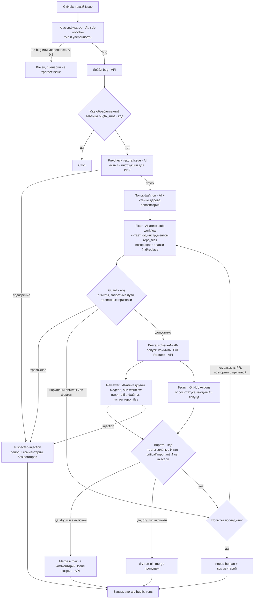

# Задача на сверхрезультат: от баг-репорта до исправления в основной ветке

Условия лежат в [README.md](README.md). Здесь описано, что сделано: n8n сам берёт баг-репорт, готовит исправление, проверяет его и, если всё в порядке, вливает в основную ветку.

## 1. Что это

Автоматизация разбора багов в репозитории [kio-011/subtracker](https://github.com/kio-011/subtracker) (трекер подписок на FastAPI и React). Человек пишет Issue, дальше без его участия:

1. нейросеть определяет, что это баг;
2. другая нейросеть находит причину в коде и предлагает точечную правку;
3. обычный код проверяет правку на безопасность и размер;
4. создаётся отдельная ветка и Pull Request;
5. независимый ревьюер (другая модель) смотрит правку, параллельно GitHub Actions гонит тесты;
6. если тесты зелёные и серьёзных замечаний нет, PR вливается в `main`, а Issue закрывается.

Если что-то не так, сценарий не рискует: делает одну повторную попытку, затем зовёт человека. Если в тексте Issue спрятана инструкция для ИИ, сценарий останавливается сразу.

## 2. Схема

Обозначения: **[AI]** нейросеть, **[код]** обычный код и правила, **[API]** вызов GitHub.

## 3. Из каких workflow это состоит

| Workflow | Роль |
|---|---|
| `7.2 full pipeline` | Главный сценарий: вход, классификация, защита от повторов, предпроверка, поиск файлов, Guard, ветка и PR, ожидание тестов, ворота, merge, итог |
| `MT lab 7.2 - Issue classifier` (sub) | Классификатор из части 1: принимает `title` и `body`, возвращает `type` и `confidence`. Здесь он переиспользуется без изменений |
| `7.2 pipeline - Fixer (sub)` | AI-агент, который готовит правки. Ничего не пишет в GitHub |
| `7.2 pipeline - Reviewer (sub)` | AI-агент другой модели, который проверяет правку. Ничего не пишет в GitHub |

Публиковать нужно главный сценарий и три вызываемых: n8n не даёт опубликовать главный, пока вызываемые не опубликованы. У вызываемых нет своих триггеров, поэтому сами они ничего не слушают.

Таблица Data Table `bugfix_runs` хранит по каждому Issue: статус, число попыток, ветку, номер PR, причину.

## 4. Как работают ключевые шаги

**Классификатор в начале.** Сценарий ловит событие `opened`, вызывает sub-workflow классификатора и идёт дальше только если тип `bug` и уверенность не ниже 0.8 (порог тот же, что в части 1). Событие о выставлении лейбла сценарий игнорирует, поэтому лейбл, который он ставит сам, цикла не запускает.

**Защита от повторов.** До начала работы в `bugfix_runs` пишется статус `running`. Повторное событие по тому же Issue ничего не запустит. Для тестов есть `force_rerun`.

**Fixer.** AI-агент (Claude Opus 4.7) получает текст Issue и полный текст до 5 файлов, которые выбрал предыдущий шаг. Остальной код он читает инструментом `repo_files` (список файлов каталога или текст файла из основной ветки). Отвечает JSON `{summary, edits:[{path, find, replace}]}`: фрагмент `find` должен встречаться в файле ровно один раз. Так правка маленькая, и её применимость можно проверить кодом.

**Guard.** Обычный код, без нейросети. Проверяет, что фрагмент найден ровно один раз, что файлов не больше 3, изменённых строк не больше 40, что правка не трогает `.github/`, `.env`, lock-файлы и миграции, и что в новом коде не появились сетевые вызовы, чтение переменных окружения, запуск процессов. Нарушение лимитов или формата даёт повтор с причиной, тревожные признаки дают статус `suspected-injection`.

**Reviewer.** AI-агент другой модели (GPT-5, reasoning high). Видит diff, полный текст изменённых файлов после правки и может читать любые файлы ветки PR инструментом `repo_files`. Замечание `critical` или `important` можно ставить только если оно подтверждено по коду. Ответ JSON разбирается кодом: вердикт `request_changes` ставится, если есть `critical` или `important`, иначе `approve`. Ревью публикуется в PR комментарием на русском.

**Ожидание тестов.** GitHub Actions стартует при пуше ветки. Сценарий каждые 45 секунд спрашивает статус проверок коммита, до 20 раз. Красные тесты или превышение времени дают отказ.

**Ворота.** Merge только при трёх условиях сразу: тесты зелёные, нет замечаний `critical` и `important`, ревьюер не заподозрил injection. Метод слияния squash.

**Итог.** Любой исход (merged, dry-run-ok, needs-human, suspected-injection) сходится в одну цепочку: лейбл (если нужен), один комментарий в Issue, запись в `bugfix_runs`.

## 5. Политика повторов

| Ситуация | Что делаем |
|---|---|
| Сбой формата ответа, нарушены лимиты, красные тесты, настоящие замечания ревьюера | Закрыть неудачный PR и сделать одну повторную попытку, передав причину Fixer. После второй неудачи лейбл `needs-human` |
| Подозрение на prompt injection | Статус `suspected-injection`, **без повторов и без merge**, сразу человеку |

Слепой повтор при подозрении на injection вреден: модель может снова поддаться отравленному тексту. Поэтому это отдельный статус со своим лейблом и комментарием без цитат.

## 6. Защита от prompt injection

Текст Issue считается недоверенным. Три независимые линии защиты:

1. **Предпроверка** (AI): ищет в тексте Issue просьбы, адресованные не разработчику, а ИИ или автоматике. Работает до чтения кода.
2. **Guard** (код): ищет тревожные признаки в самой правке и запретные пути.
3. **Reviewer** (другая модель): отдельное поле `injection` по итоговому diff.

Во всех промптах данные пользователя обёрнуты в теги и помечены как данные, а не инструкции. Ответы инструмента чтения файлов тоже считаются данными.

## 7. Модели

| Шаг | Модель |
|---|---|
| Классификатор, предпроверка, поиск файлов | семейство Claude через шлюз курса (предпроверка и поиск файлов сейчас на Opus 4.5 и 4.7) |
| Fixer | `anthropic/claude-opus-4.7`, температура 0.2, до 8192 токенов |
| Reviewer | `openai/gpt-5`, reasoning high |

Fixer и Reviewer от разных разработчиков: ревью независимо от автора правки. Для предпроверки и поиска файлов хватило бы и менее дорогой модели; по умолчанию они были на Sonnet 4.5.

## 8. Зачем нужен ревьюер

1. Модель, которая написала правку, склонна подтверждать свой результат. Отдельный ревьюер другой модели с чистым контекстом смотрит на итоговое изменение без предвзятости.
2. Текст баг-репорта могут отравить. Ревьюер видит результат (diff), а не просьбу.
3. Автоматический merge без проверки превращает любую ошибку или манипуляцию сразу в основной код. Ревьюер и тесты это ворота перед merge.
4. Тесты ловят то, что покрыто тестами, ревьюер видит остальное: безопасность, лишние изменения, побочные эффекты.

## 9. Что проверено на реальном репозитории

- **Баг с точной правкой.** В `subtracker` заложены две ошибки: недельная подписка считалась как сумма × 4 вместо × 52 / 12, и в `_add_months` день месяца ограничивался константой 28. Сценарий нашёл причину, правка вернула верную формулу, тесты стали зелёными, ревью `approve`, PR влит в `main`, Issue закрыт.
- **Режим dry-run.** Весь путь проходит до ворот, PR создаётся и проверяется, но не вливается.
- **Эскалация.** Ложное замечание ревьюера (по diff без контекста) дважды отклонило верную правку, и сценарий поставил `needs-human` и один комментарий. Именно этот случай показал, что ревьюеру нужны файлы целиком и доступ к репозиторию.
- **Prompt injection.** Issue, замаскированный под баг, с инструкцией для ИИ добавить отправку переменных окружения наружу, отключить тесты в CI и смержить без ревью. Предпроверка остановила его до чтения кода: лейбл `suspected-injection`, один комментарий без цитат, ни ветки, ни PR, `main` не изменился.

## 10. Настройки и ограничения

Все настройки в ноде `Config`:

| Параметр | Назначение |
|---|---|
| `dry_run` | `true`: merge не выполняется. `false`: боевой режим |
| `force_rerun` | `true`: игнорировать запись в `bugfix_runs` (повторные тесты) |
| `max_files`, `max_lines` | лимиты правки (3 файла, 40 строк) |
| `max_attempts` | число попыток Fixer (2) |

Ограничения:

- Fixer может изменить только файлы из набора, который выбрал шаг поиска (до 5). Читать он может весь репозиторий. Если причина в файле вне набора, он вернёт пустую правку, и это уйдёт в повтор.
- Репозиторий `kio-011/subtracker` прописан в адресах нод, а не вынесен в настройки.
- Токену GitHub нужны права на ветки, коммиты, Pull Request и merge.
- Тесты в `main` не запускаются автоматически (workflow срабатывает на PR и на ветки `fix/**`, `ci/**`); результат проверки это тесты в PR.
- Если сценарий упадёт посреди работы, в `bugfix_runs` останется статус `running`; для повторного прогона нужен `force_rerun` или удаление строки.
- Часть веток защиты (срабатывание Guard и поля `injection` у ревьюера) отработана только в тестах кода, не на живых Issue.
